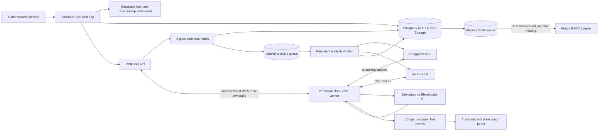

# Architecture

Existing frontend/server rendering is preserved. The Vite preset builds a Cloudflare-targeted web app; persistent audio belongs in the separately supervised Node voice process, not an ordinary serverless request handler.

## Boundaries

Browser credentials are Supabase publishable/session credentials only. Server handlers verify the current user through Supabase, resolve active membership and authorize the call. Service-role clients bypass RLS, so explicit company filters and call authorization are required there. Client SQL grants prevent edits to provider IDs and privileged analysis records. Composite tenant/call foreign keys prevent mismatched parent ownership.

Webhook signatures are mandatory even if a deployment has no keys (requests then fail closed). HMAC URLs bind call/company/prospect. Media upgrade signatures and expiring one-use database tokens bind stream sessions to actual provider call IDs. Worker data writes are company-scoped. No conversational tool can perform arbitrary CRM, trading or account actions.

Call state describes the Twilio **parent leg**: created → ringing → in_progress → completed, with failed/cancelled/missed and conservative provider_unknown handling. It does not prove the prospect answered the bridge. Sequence fencing prevents late callback regression. The reconciliation worker reads actual provider state for known SIDs; a same-terminal-state duration can be completed later without changing the state. Portable recording uploads use separate upload/analysis states.

Analysis jobs have leases, attempt bounds, retry delays and atomic final commits. SQL rejects stale ownership. A CRM outbox row is committed with analysis but remains blocked until an actual supported adapter exists. AI-predicted conversion does not change the recorded conversion flag.

## Voice limitations

Coaching and customer-facing response generation are separate paths. Only the inbound AI mode sends synthesized audio into the telephone stream. VAD aborts obsolete output; generation fencing discards output even when a provider ignores cancellation. Memory is bounded; a complete bounded call transcript is persisted separately from the shorter coaching window. Generated AI responses carry an explicit playback-unverified label: Twilio mark acknowledgement and playout timing are not implemented.

LLM first-token and TTS generation timing are emitted as observed stage metrics. Telephone round-trip latency, STT accuracy, Russian model/voice availability and actual barge-in quality are unverified. TTS currently buffers a bounded sentence before sending mu-law chunks; this is not a validated low-latency production voice system.
